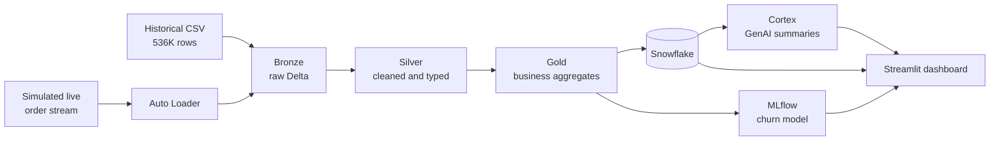

# RetailPulse

**A real-time retail analytics pipeline: from raw transactions to dashboards, churn predictions, and plain-English answers.**

Built end to end with Spark, Delta Lake, Snowflake, MLflow, and Snowflake Cortex.

> **Status:** in progress. Replace this line with `Complete` when Phase 9 is done.
> **Live demo:** TBD (Streamlit link) | **Demo video:** TBD (Loom link)

---

## 1. The problem

Retail managers usually see yesterday's numbers tomorrow. Raw transaction data arrives messy (cancellations mixed with sales, duplicates, missing customers, dates stored as text), so every report re-cleans it differently and the figures disagree.

RetailPulse fixes that by ingesting orders continuously, cleaning them once into trustworthy layers, flagging unusual sales activity, predicting which customers are likely to churn, and letting non-technical users ask questions in plain English.

---

## 2. Architecture


### Medallion layers

| Layer | Purpose | Rules |
|---|---|---|
| **Bronze** | Faithful copy of the source | No cleaning. All columns kept as text. Adds `_ingested_at` and `_source_file` |
| **Silver** | Trustworthy, typed data | Parse dates, fix ID types, flag cancellations and missing customers, remove exact duplicates |
| **Gold** | Business-ready tables | Daily sales by country, top products, customer-level (RFM) summaries |

Bronze is never modified, so any Silver rule can be changed and rebuilt from the raw data.

---

## 3. Tech stack

| Category | Tools |
|---|---|
| Processing | Databricks, Apache Spark, PySpark |
| Storage | Delta Lake, Unity Catalog volumes |
| Streaming | Spark Structured Streaming, Auto Loader |
| Warehouse | Snowflake |
| Orchestration | Databricks Workflows |
| ML | MLflow, scikit-learn |
| GenAI | Snowflake Cortex |
| Dashboard | Streamlit |
| Language | Python, SQL |
| Version control | Git, GitHub (feature branches and pull requests) |

---

## 4. Data

- **Source:** [E-commerce Business Transaction](https://www.kaggle.com/) dataset on Kaggle (UK online gift retailer)
- **License:** CC0 (public domain)
- **Size:** 536,350 rows, 8 columns, dated 2018-12-01 to 2019-12-09
- **Streaming layer:** the live feed is **simulated** with a Python script, because no free real-time retail feed exists. Historical data is real.

### What the exploration found

These findings drove the cleaning rules (full detail in [`docs/data_dictionary.md`](docs/data_dictionary.md)):

| Finding | Decision |
|---|---|
| Dates stored as `m/d/Y` text | Parsed explicitly in Silver |
| 8,585 rows are cancellations (`C` prefix always matches negative quantity) | Keep `Quantity` signed, add `is_cancellation` flag |
| 55 rows have no `CustomerNo` | Keep them, add `has_customer` flag, filter per use case |
| `CustomerNo` loads as float because of nulls | Convert to nullable integer, then string, so joins do not break |
| 5,200 exact duplicate rows (about 1%) | Dropped in Silver only; Bronze keeps them |
| Quantity extremes of +/-80,995 | Kept as a real business event; considered in anomaly rules |

---

## 6. Repository structure

```
retailpulse/
├── README.md
├── architecture_diagram.png
├── requirements.txt
├── data_ingestion/     # exploration notebook, stream simulator
├── etl/                # Bronze, Silver, Gold PySpark code
├── snowflake/          # SQL scripts and Cortex queries
├── ml/                 # churn model, MLflow config
├── dashboard/          # Streamlit app
├── docs/               # data dictionary, design notes
└── data/               # raw data (git-ignored, not committed)
```

---

## 7. How to run it

### Prerequisites
Python 3.9+, a Databricks workspace, a Snowflake trial account, Git.

### Setup
```bash
git clone https://github.com/Yousufkhalid7/RetailPulse.git
cd RetailPulse
python -m venv venv
venv\Scripts\activate          # Windows
# source venv/bin/activate     # Mac/Linux
pip install -r requirements.txt
```

### Run order
1. Download the dataset from Kaggle and place it in `data/` (not committed).
2. Upload it to a Databricks volume and run the notebooks in `etl/` in order: Bronze, Silver, Gold.
3. Start the stream simulator in `data_ingestion/`, then the streaming notebook.
4. Load Gold tables into Snowflake using the scripts in `snowflake/`.
5. Run the training notebook in `ml/`.
6. Start the dashboard: `streamlit run dashboard/app.py`

Credentials live in a local `.env` file (git-ignored). See `.env.example` for the variable names.

---

## 10. Author

**Your Name** | [GitHub](https://github.com/Yousufkhalid7) | [LinkedIn](https://www.linkedin.com/) | your.email@example.com
